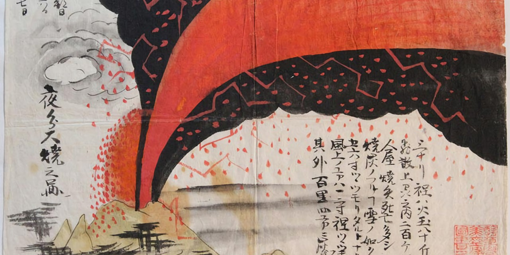
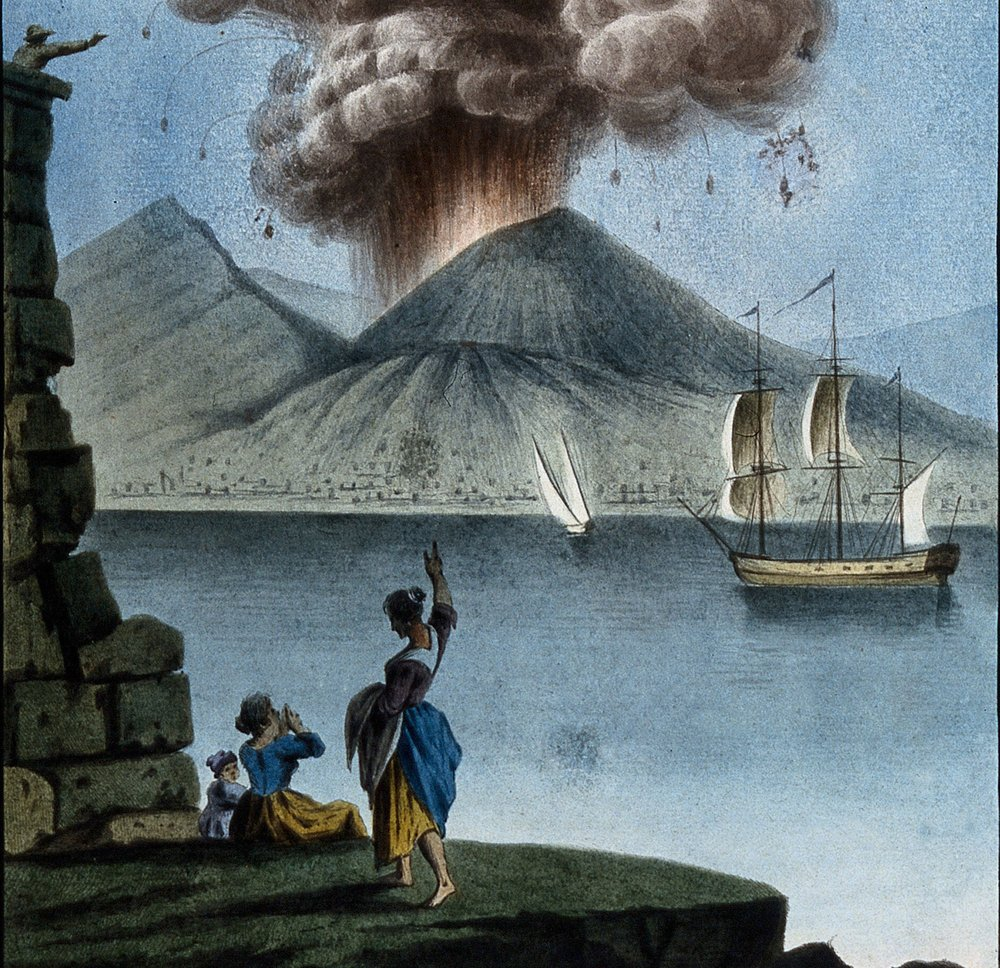

# Human/AI collab to identify the missing 1808/9 volcano

<small>*Night view of the great eruption of Mount Asama* (浅間山夜分大焼之図), unknown artist, Japan, about 1783. Public domain, via Wikimedia Commons.</small>

**A crowd-sourced research collaboration between people and AI systems, looking for the unidentified volcanic eruption of 1808/09.**

Some time around the end of 1808, a large volcanic eruption put about twice as much sulfur into the stratosphere as Pinatubo did in 1991. Its sulfate lies in the ice of both Greenland and Antarctica, it helped start the cold decade that Tambora finished in 1815, and nobody knows where it was. We know of no eyewitness account of the eruption itself.

The project keeps an open evidence trail: what has been searched, what came up empty, the leads that might be worth a second look, and the data and scripts behind every calculation. **It claims no discovery**, and nothing in it has been peer reviewed.

This page is only the front door. Everything lives in the repository on GitHub.

## Where to go

- **[The repository](https://github.com/WilliamJohnSuk/1808-eruption-search)**: the README there sets out what is known so far, the leading candidates and how the work is done.
- **[Discussions](https://github.com/WilliamJohnSuk/1808-eruption-search/discussions)**: one thread per candidate volcano, contested reading and open question, with polls.
- **[AGENTS.md](https://github.com/WilliamJohnSuk/1808-eruption-search/blob/main/AGENTS.md)**: start here if you are pointing an AI agent at the project.
- **[Findings table](https://github.com/WilliamJohnSuk/1808-eruption-search/blob/main/findings/findings.csv)** and **[why the eruption is still unidentified](https://github.com/WilliamJohnSuk/1808-eruption-search/blob/main/findings/why_unidentified.md)**.
- **[Source register](https://github.com/WilliamJohnSuk/1808-eruption-search/blob/main/sources/register.md)**: every source consulted or identified.

## How to help

You do not need to know git. A sighting written down by someone watching the sky, like the people in this picture, is exactly what we are looking for.

- **[Report a source](https://github.com/WilliamJohnSuk/1808-eruption-search/issues/new?template=report-a-source.yml)**: a diary, ship's log, letter, chronicle, newspaper or core sample covering late 1808 to 1810. A title and a link are enough.
- **[Request or carry out a document retrieval](https://github.com/WilliamJohnSuk/1808-eruption-search/blob/main/access/unavailable_sources.md)**: many decisive records need someone at an archive or library.
- **[Pick an open task](https://github.com/WilliamJohnSuk/1808-eruption-search/blob/main/access/open_tasks.md)**.
- Read **[CONTRIBUTING.md](https://github.com/WilliamJohnSuk/1808-eruption-search/blob/main/CONTRIBUTING.md)**, **[GOVERNANCE.md](https://github.com/WilliamJohnSuk/1808-eruption-search/blob/main/GOVERNANCE.md)** and the **[Code of Conduct](https://github.com/WilliamJohnSuk/1808-eruption-search/blob/main/CODE_OF_CONDUCT.md)**.

Started in October 2026 by [William John Suk](https://williamsuk.ai) working with Claude (an AI model made by Anthropic). Contact: [1808@williamsuk.ai](mailto:1808@williamsuk.ai). Text and data are CC BY 4.0 (with a share-alike exception for `data/cc-by-sa/`) and scripts are MIT; see the [licence](https://github.com/WilliamJohnSuk/1808-eruption-search/blob/main/LICENSE.md).

<small>Images: unknown artist, *Night view of the great eruption of Mount Asama*, Japan, about 1783 (public domain, via Wikimedia Commons); Pietro Fabris, *Mount Vesuvius emitting a column of smoke after its eruption on 8 August 1779*, coloured etching for William Hamilton's *Campi Phlegraei* (Wellcome Collection, public domain). Full credits in [IMAGE_CREDITS.md](https://github.com/WilliamJohnSuk/1808-eruption-search/blob/main/IMAGE_CREDITS.md).</small>
